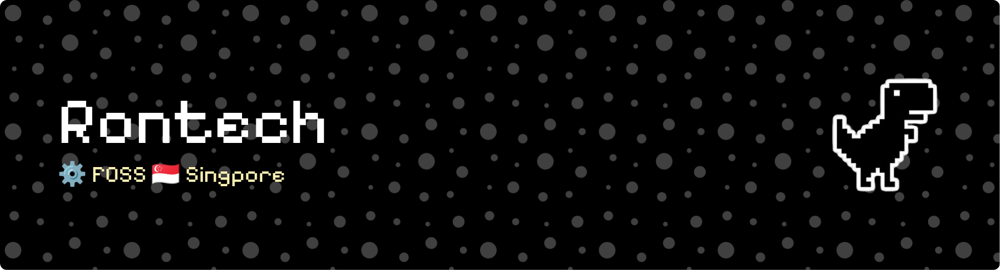

## 👋 Hey there, I'm Ron

I build open-source software for Linux: desktop shells, installers and everyday apps, with a lot of care for how they look and feel. I like clean, modern UI (especially Material 3 Expressive) and tools that make Linux friendlier to use.

## 🛠️ What I'm working on
none for now...

## 🧰 Tech I use

